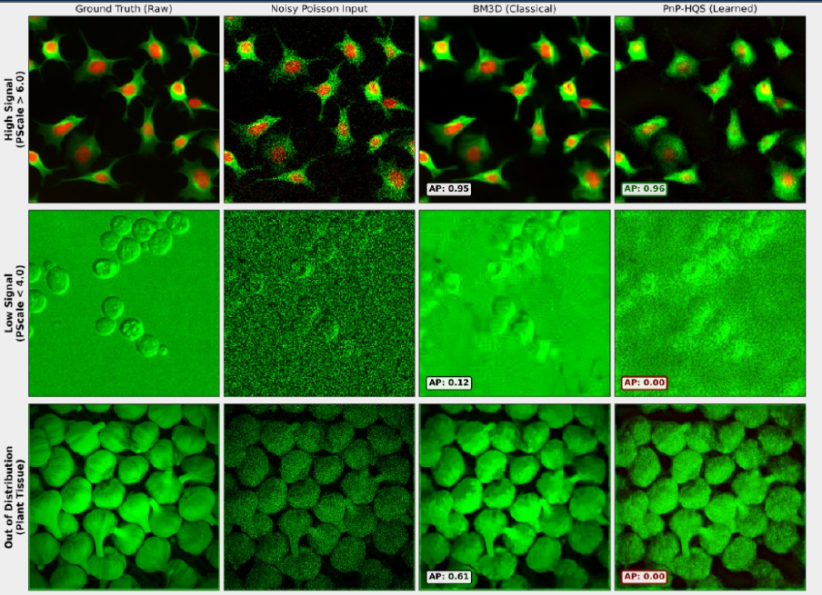

# Fluorescence denoising for cell segmentation

**BM3D · VST-TV · VST-Wiener · Python · EECS 556 team project · University of Michigan, 2026**

Classical image restoration baselines for fluorescence microscopy, evaluated through downstream cell segmentation. Our team compared classical and learned denoisers under simulated Poisson noise while holding the Cellpose segmentation model fixed. I implemented and evaluated the BM3D, VST-TV, and VST-Wiener baselines.

[Technical report (PDF, 2 pages)](../output/pdf/EECS556_technical_report.pdf) · [Classical implementations](https://github.com/npkamath/556DenoisingFluorescence/tree/e6b237dd2515c976ecf692fed333d9970c90b9f1/src/denoisers/classical) · [Team benchmark figure](https://github.com/npkamath/556DenoisingFluorescence/blob/e6b237dd2515c976ecf692fed333d9970c90b9f1/figures/comparison/ap_comparison.png) · [Repository](https://github.com/npkamath/556DenoisingFluorescence)

## My contribution

I implemented three classical baselines using an Anscombe variance stabilizing transform (VST), and evaluated them on the same 68-image set through the shared frozen Cellpose and AP evaluation pipeline:

| Baseline | Implementation |
| --- | --- |
| BM3D | [Anscombe VST plus BM3D](https://github.com/npkamath/556DenoisingFluorescence/blob/e6b237dd2515c976ecf692fed333d9970c90b9f1/src/denoisers/classical/denoise_bm3d_vst.py) |
| Poisson-TV | [TV denoising in the VST domain](https://github.com/npkamath/556DenoisingFluorescence/blob/e6b237dd2515c976ecf692fed333d9970c90b9f1/src/denoisers/classical/denoise_poisson_tv.py) |
| Wiener | [Wiener filtering in the VST domain](https://github.com/npkamath/556DenoisingFluorescence/blob/e6b237dd2515c976ecf692fed333d9970c90b9f1/src/denoisers/classical/denoise_wiener_vst.py) |

For the BM3D module, I adapted the existing `bm3d` package to the project's Poisson inputs:

- **Noise model:** recover simulated Poisson counts from each image's recorded scale, apply the Anscombe VST, and map the denoised output back with an approximate inverse.
- **Channel processing:** denoise the red nucleus and green cytoplasm channels, normalize intensities and noise sigma consistently, and guard against nearly constant inputs.
- **Batch processing:** load the per-image scale table, process `.npy` inputs, and save float32 outputs with clipping and finite value handling.

I also contributed to the proposal's quantitative performance predictions, evaluation protocol, reproducibility plan, and extension discussion, followed by project reporting and README review. The [March 25 submission](https://github.com/npkamath/556DenoisingFluorescence/commit/f4e8d8cacf686e8a49baed1f9fa6310e4016eaea) records the BM3D module; the [April 16 submission](https://github.com/npkamath/556DenoisingFluorescence/commit/825285d9c2058a00381bd7d28e83c97131b0541a) adds the TV and Wiener scripts. A later team reorganization moved the files into `src/denoisers/classical/`.

## Reported team results

The team's [archived comparison figure](https://github.com/npkamath/556DenoisingFluorescence/blob/e6b237dd2515c976ecf692fed333d9970c90b9f1/figures/comparison/ap_comparison.png) reports the following mean segmentation scores:


*Team benchmark, April 2026. The full figure includes teammates' methods for context. Italic timing labels are archival annotations and have not been validated here.*

| Input to the frozen segmenter | Mean AP@0.5 |
| --- | ---: |
| Noisy images | 0.3171 |
| **BM3D denoised images** | **0.5559** |
| Poisson-TV denoised images | 0.5069 |
| Wiener denoised images | 0.4735 |
| Clean reference images | 0.7343 |

In this reported comparison, all three classical baselines achieved higher mean segmentation AP than the noisy input. BM3D had the highest mean AP among these three, with a remaining gap to the clean reference. These values are transcribed from the public team figure at revision `e6b237d`. They have not been reproduced for this portfolio.

## Case analysis

The team's presentation includes the following selected examples. Columns show the reference image, Poisson-corrupted input, BM3D restoration, and the team's learned PnP-HQS restoration. The AP labels are per-case annotations from the original figure, separate from the 68-image means above.



*Source: EECS 556 team presentation, April 2026, by Ninad Kamath, Bingxu Lin, and Ruoyu Wu. This is the comparison region from slide 12, shown on its original light background. My implementation contribution is the BM3D baseline; the learned PnP-HQS extension is team work.*

| Selected case | Displayed BM3D AP | Displayed PnP-HQS AP | Interpretation |
| --- | ---: | ---: | --- |
| Top row: high-scoring example | 0.95 | 0.96 | Both methods achieve high segmentation scores on this selected example; their small difference does not establish an overall ranking. |
| Middle row: difficult example | 0.12 | 0.00 | Visible noise suppression still leaves poor segmentation. This case shows why restoration should be evaluated through the downstream task. |
| Bottom row: different method behavior | 0.61 | 0.00 | Recognizable image structure remains in both outputs, yet the displayed segmentation scores differ sharply. Image appearance alone does not explain the difference. |

These selected cases illustrate variation across images. They do not establish a failure mechanism or a general claim about tissue types. The original sample identifiers, noise scales, and masks have not been independently checked for this portfolio, so the figure remains an attributed team example rather than a new reproduction.

## Evaluation design

> **Poisson noisy images** → **VST with BM3D / TV / Wiener** → **Frozen Cellpose cyto2** → **Segmentation AP@0.5**

The evaluation uses 68 public Cellpose test image and mask pairs. The same pretrained `cyto2` model processes noisy, denoised, and clean inputs with `channels=[2, 1]`. The metric is the mean of per-image `TP / (TP + FP + FN)` scores at an intersection over union (IoU) threshold of 0.5.

This design measures the usefulness of restoration for segmentation. Its scope is synthetic Poisson corruption and a fixed segmentation model; results depend on that setup and the BM3D script's approximate inverse VST.

## Team and development context

The repository is owned by `npkamath`. Data preparation, segmentation, evaluation, and the remaining denoisers are shared team work. My implementation contribution covers the three classical baselines above, together with evaluation and project writing, including a [README update](https://github.com/npkamath/556DenoisingFluorescence/commit/a07c80478dcf5f3cd23c0fe5e217efb7d34e1243). Development included both my own coding and AI assistance.

## Reproduction

The run guide follows the [April 22 reference revision](https://github.com/npkamath/556DenoisingFluorescence/tree/e6b237dd2515c976ecf692fed333d9970c90b9f1). Commands have been checked against source, but have not been executed for this portfolio. Most upstream dependencies are unpinned.

The worked commands cover all three classical baselines with the defaults in the pinned source: BM3D `sigma_vst=1.0`, VST-TV `weight=0.10` with `n_iter=200`, and VST-Wiener `mysize=5`. These are source-default run instructions; the original figure remains an archival result.

<details>
<summary>Environment, data, commands, and output checks</summary>

The guide uses repository revision `e6b237dd2515c976ecf692fed333d9970c90b9f1` from April 22, 2026. Paths below are relative to a fresh checkout of the team repository. Prerequisites are Git, Python 3.10, access to the public test images and masks, and the pretrained `cyto2` weights used by Cellpose. The segmentation commands use the CPU option.

### 1. Get the code and prepare the environment

```sh
git clone https://github.com/npkamath/556DenoisingFluorescence.git
cd 556DenoisingFluorescence
git checkout --detach e6b237dd2515c976ecf692fed333d9970c90b9f1
python3.10 -m venv .venv
source .venv/bin/activate
python -m pip install -r requirements.txt
```

The upstream requirements constrain Cellpose to `>=3.0,<4.0`. Most other dependencies are unpinned, so the revision alone does not fix the complete runtime environment. Retain the installed package versions and model weights with any reproduced results.

### 2. Obtain the public test data

Follow the [team dataset instructions](https://github.com/npkamath/556DenoisingFluorescence/blob/e6b237dd2515c976ecf692fed333d9970c90b9f1/README.md#dataset) to obtain `test.zip` from the [Cellpose dataset page](https://www.cellpose.org/dataset). Place the extracted image and mask pairs directly under:

```text
data/raw/test/
  000_img.png
  000_masks.png
  ...
```

This is an example of the expected naming pattern. Check that all 68 image and mask pairs are present. The optional `cyto2` training dataset is not required for these classical evaluation routes.

The provider's download page currently asks for an institutional email and acceptance of its terms. The dataset is obtained separately from the provider.

### 3. Prepare Poisson noise and run the denoisers

The data preparation step uses seed 42 and saves each image's noise scale to `data/noise_params.csv`. Run it once in the fresh checkout, then use those same generated inputs for every compared method.

```sh
python src/data_prep/data_prep.py --noise_mode poisson --seed 42
```

Run each baseline on that same noisy input directory and scale table. The TV script applies Chambolle TV denoising after the VST; its historical `poisson_tv` filename does not mean it directly solves a Poisson likelihood objective.

**BM3D**

```sh
python src/denoisers/classical/denoise_bm3d_vst.py \
  --noisy_dir data/noisy/poisson \
  --pscale_csv data/noise_params.csv \
  --out_dir results/denoised/bm3d \
  --sigma_vst 1.0
```

**VST-TV**

```sh
python src/denoisers/classical/denoise_poisson_tv.py \
  --noisy_dir data/noisy/poisson \
  --pscale_csv data/noise_params.csv \
  --out_dir results/denoised/poisson_tv \
  --weight 0.10 --n_iter 200
```

`weight` controls smoothing in the normalized VST domain, and `n_iter` is the maximum number of Chambolle iterations. The script uses `skimage.restoration.denoise_tv_chambolle`, denoises red and green independently, and maps back through its safe approximate inverse Anscombe transform.

**VST-Wiener**

```sh
python src/denoisers/classical/denoise_wiener_vst.py \
  --noisy_dir data/noisy/poisson \
  --pscale_csv data/noise_params.csv \
  --out_dir results/denoised/wiener \
  --mysize 5
```

`mysize=5` selects a 5 by 5 neighborhood for `scipy.signal.wiener` in the VST domain. The script processes red and green independently and uses its safe approximate inverse Anscombe transform. Both TV and Wiener save clipped float32 arrays and handle non-finite output values.

### 4. Segment and evaluate

```sh
for method in bm3d poisson_tv wiener; do
  python src/pipeline/segment.py \
    --input_dir "results/denoised/$method" \
    --output_dir "results/pred_masks/$method" --no_gpu
  python src/pipeline/evaluate.py \
    --gt_dir data/masks \
    --pred_dir "results/pred_masks/$method" \
    --out_dir results/ap_scores --method_name "$method"
done
```

For the noisy and clean references, run the same segmentation and evaluation steps on the prepared inputs:

```sh
python src/pipeline/segment.py \
  --input_dir data/noisy/poisson \
  --output_dir results/pred_masks/noisy --no_gpu
python src/pipeline/evaluate.py \
  --gt_dir data/masks --pred_dir results/pred_masks/noisy \
  --out_dir results/ap_scores --method_name noisy

python src/pipeline/segment.py \
  --input_dir data/clean \
  --output_dir results/pred_masks/clean --no_gpu
python src/pipeline/evaluate.py \
  --gt_dir data/masks --pred_dir results/pred_masks/clean \
  --out_dir results/ap_scores --method_name clean
```

Cellpose uses the project's green cytoplasm and red nucleus mapping, `channels=[2, 1]`. Keep the input set, noise realization, model weights, and segmentation settings the same across methods.

### Expected outputs and completeness checks

These are the files the referenced scripts are designed to write; they are not bundled experiment results.

In the paths below, `<method>` is `bm3d`, `poisson_tv`, or `wiener`, matching the output directories and evaluation labels above.

| Output | Contents |
| --- | --- |
| `data/noise_params.csv` | Image identifiers and Poisson noise scales |
| `results/denoised/<method>/*.npy` | Denoised `(H, W, 3)` float32 arrays, clipped to `[0, 1]` |
| `results/pred_masks/<method>/*.npy` | `(H, W)` integer instance masks |
| `results/ap_scores/<method>.csv` | Per-image scores across IoU thresholds |
| `results/ap_scores/<method>_summary.csv` | Mean scores and matching counts at each threshold |

Before treating an evaluation as the full 68-image benchmark, verify that the noisy images, each method's denoised images and predicted masks, and the ground-truth masks have the same 68 `.npy` filenames. Each method's per-image CSV should contain those same 68 unique image identifiers. The evaluator scores matching filenames and can return a result for an incomplete subset. Also check output dimensions and finite values, retain the run log, and preserve the package versions, model weights, seed, and noise scale CSV.

</details>

<details>
<summary>Source files</summary>

- [Project README at the referenced revision](https://github.com/npkamath/556DenoisingFluorescence/blob/e6b237dd2515c976ecf692fed333d9970c90b9f1/README.md)
- [Dependency requirements](https://github.com/npkamath/556DenoisingFluorescence/blob/e6b237dd2515c976ecf692fed333d9970c90b9f1/requirements.txt)
- [VST-TV arguments and implementation](https://github.com/npkamath/556DenoisingFluorescence/blob/e6b237dd2515c976ecf692fed333d9970c90b9f1/src/denoisers/classical/denoise_poisson_tv.py)
- [VST-Wiener arguments and implementation](https://github.com/npkamath/556DenoisingFluorescence/blob/e6b237dd2515c976ecf692fed333d9970c90b9f1/src/denoisers/classical/denoise_wiener_vst.py)
- [Data preparation](https://github.com/npkamath/556DenoisingFluorescence/blob/e6b237dd2515c976ecf692fed333d9970c90b9f1/src/data_prep/data_prep.py)
- [Frozen Cellpose segmentation](https://github.com/npkamath/556DenoisingFluorescence/blob/e6b237dd2515c976ecf692fed333d9970c90b9f1/src/pipeline/segment.py)
- [Evaluation and CSV outputs](https://github.com/npkamath/556DenoisingFluorescence/blob/e6b237dd2515c976ecf692fed333d9970c90b9f1/src/pipeline/evaluate.py)

</details>
